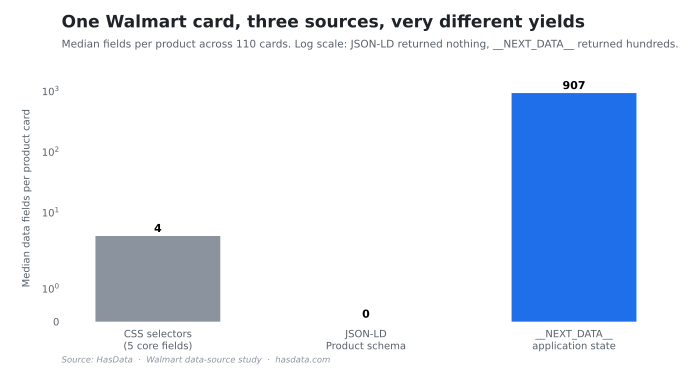

# Walmart Scraping Examples (Python)


Working Python examples for Walmart product data, from collecting card URLs off the search pages to a complete scraper, plus a measured comparison of the three places the same product data lives on a card. The written tutorial is [Web Scraping Walmart Using Python](https://hasdata.com/blog/web-scraping-walmart-using-python?utm_source=github&utm_medium=syndication&utm_campaign=web-scraping-walmart-using-python&utm_content=walmart-scraping-readme).

## Table of Contents

- [Requirements](#requirements)
- [Project Structure](#project-structure)
- [The Examples](#the-examples)
- [The Sources Study](#the-sources-study)
- [Disclaimer](#disclaimer)
- [More Resources](#more-resources)

## Requirements

Python 3.10 or newer, `requests`, `beautifulsoup4` and `lxml`, the parser the scripts hand to BeautifulSoup.

```bash
pip install requests beautifulsoup4 lxml
```

The scripts read the API key from the `HASDATA_API_KEY` environment variable. In the tutorial's checks a plain request to Walmart returned a challenge page from both a datacenter and a home IP, which `ex_blocked.py` demonstrates on purpose.

## Project Structure

Examples are one file each, the study and its raw results are in their own folder.

```
walmart-scraping/
├── Python/
│   ├── ex_blocked.py       # what a plain request actually returns
│   ├── ex_links.py         # card URLs off the search pages
│   ├── ex_selectors.py     # the five-field selector route
│   ├── ex_nextdata.py      # the __NEXT_DATA__ route
│   ├── ex_api_params.py    # request parameters that matter
│   └── ex_complete.py      # the full scraper, links to CSV
└── study/                  # the three-sources measurement + raw JSON
```

A sample `keywords.txt` ships next to the scripts, and the collectors write `links.csv` and `result.csv` beside it.

## The Examples

The route starts where Walmart actually pushes back. `ex_blocked.py` shows the challenge page a plain request gets, `ex_links.py` collects product URLs from one search page per keyword in `keywords.txt`, `ex_selectors.py` reads the five visible fields the tutorial teaches, `ex_nextdata.py` parses the embedded `__NEXT_DATA__` JSON instead, and `ex_complete.py` chains it all into a CSV.

## The Sources Study

`study/sources_study.py` fetched 110 product cards once each and extracted the same card three ways offline. The selector route yields its 4 core fields with rates around 97%, except rating, which the cards render differently and the selectors miss entirely. JSON-LD Product schemas were present on 0 of 110 cards. The embedded `__NEXT_DATA__` carried a median of 907 leaf fields per card, which is why the tutorial's deep route goes through it. Raw per-card data is in `study/results/`.



The visible markup carries a handful of fields while the embedded JSON carries the whole product.

## Disclaimer

The scripts fetch publicly visible product pages. Whether and how such collection is appropriate depends on jurisdiction, the site, and the use, and nothing in this repository is legal advice. [Is Web Scraping Legal?](https://hasdata.com/blog/is-web-scraping-legal?utm_source=github&utm_medium=syndication&utm_campaign=web-scraping-walmart-using-python&utm_content=walmart-scraping-readme) covers how we think about the question.

## More Resources

- [Web Scraping Walmart Using Python](https://hasdata.com/blog/web-scraping-walmart-using-python?utm_source=github&utm_medium=syndication&utm_campaign=web-scraping-walmart-using-python&utm_content=walmart-scraping-readme), the tutorial these examples come from
- [Scraping Amazon Product Data Using Python](https://hasdata.com/blog/scraping-amazon-product-data-using-python?utm_source=github&utm_medium=syndication&utm_campaign=web-scraping-walmart-using-python&utm_content=walmart-scraping-readme), the same approach on the other marketplace
